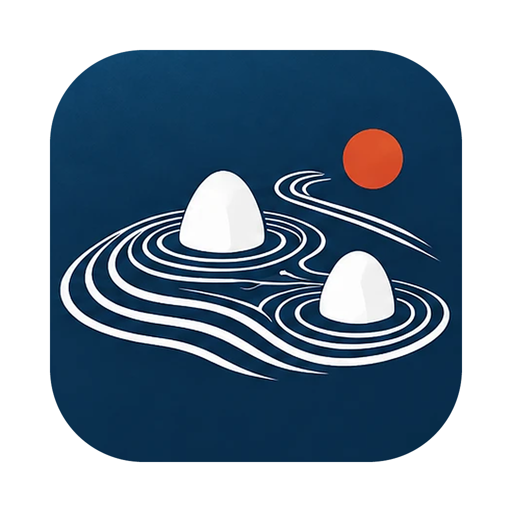

# KareSanScape

**Ontology-driven Technology Landscape** — 特許の一覧から、技術のまとまりと「似ている理由」を地図にするデスクトップアプリです（旧名 OntoMap）。



- 特許の一覧（CSV・TSV・Excel）を取り込むと、文書の近さで二次元の地図（点・等高線・クラスター名）を描きます。
- 近さは 2 通りで測り、切り替えて比べられます。
  - **意味の類似性**: 日本語の文埋め込みモデル（cl-nagoya/ruri-v3-30m）で、文章の内容が似ているか
  - **技術関係の類似性**: 辞書（オントロジー）で課題・解決手段・用途の語を拾い、「手段→課題を解決する」「手段→用途に使われる」などの関係構造が似ているか
- 選んだ 2 件について、**類似の根拠**（要約・一致した関係・関係を取り出した原文・相違点）を示します。要約はルールで組み立て、生成 AI は使いません。
- **異用途の類似技術**: 技術関係は近いのに IPC から見た用途が重ならない組を一覧にし、2 件を比較します。
- 辞書は 2 段です。**共通辞書**（分野で共有。分野別辞書に分け、文書の IPC・FI で切り替える）と、**このマップの追加語**（マップの文書で拾えない語を候補から採用）。共通辞書は、チャットの AI に下書きさせた CSV から作ったり、マップで採用した語を登録したりして育てられます。
- 処理はすべて手元の Mac で行います。外部サービスへは送信しません。

## 起動

```bash
uv sync --all-extras --group dev
```

```bash
.venv/bin/ontomap-app serve
```

ブラウザで画面が開きます。保存先は `~/OntoMap`（環境変数 `ONTOMAP_HOME` で変更）。初回は文埋め込みモデル（約 120MB）を取得します。

Mac アプリ（`KareSanScape.app`）を手元で作る場合（Xcode の Command Line Tools が要ります）:

```bash
bash packaging/macos/build_app.sh "$PWD/.venv/bin/ontomap-app" "$HOME/Applications/KareSanScape.app"
```

## このリポジトリに含まないもの

- 特許データ（明細書・要約・抽出した段落）。検証には、特許検索サービス（Summaria-MCP）で集めた国内特許（無機材料 1,200 件、MOF 614 件、電池 600 件、半導体 600 件）を使いました。再配布の条件を確かめていないため、データは含めていません。集め方と抽出の決まりは `datasets/*/collection_report.md` にあります。
- 実験の出力（`runs/`）。

辞書は `config/` にあります（`ontology_inorganic_v1.yaml` = 無機材料、`config/modules/` = 全分野共通＋無機材料・電池・半導体の分野別辞書）。画面の設計は `docs/UI設計_現状_20261021.md` を参照してください。

## 研究用のコマンド（比較実験）

以下は、文章ベクトル方式とオントロジー方式を比べた実験のコマンドです。

文書を「概念（ノード）と意味のある関係（エッジ）」で表し、構造と意味をあわせた文書間距離から二次元の俯瞰図を作ります。
文章ベクトル方式と比べる実験（実験計画書 Ver.1.0）を、データ確定から報告書まで通して実行します（設計書は含めていません）。

### 使い方

```bash
uv sync --all-extras --group dev
```

```bash
.venv/bin/python -m ontomap.cli run-all
```

```bash
.venv/bin/python -m ontomap.cli bench
```

`run-all` は計画書 11 章の ①〜⑧ を順に実行し、`runs/<run_name>/` に成果物を書きます。初回は文埋め込みモデル（cl-nagoya/ruri-v3-30m、約 120MB）を取得します。

| 出力 | 中身 |
|---|---|
| data/documents.csv | doc_id, source_type, tech_domain, text, char_count, original_id |
| data/ontology.json | concept_id, preferred_label, aliases, parent_ids, relation_types |
| data/review_sheet.csv | 制御文書の論理を人が確認するシート |
| graphs/gold・dict/triples.jsonl | doc_id, subject_id, predicate, object_id, role, confidence, evidence_span ほか |
| similarity/similarity_*.npy | 200×200 の類似度行列。設定は manifest.json |
| maps/map_coords.csv | doc_id, method, reducer, x, y, seed |
| maps/movement.csv | 手法間で各文書が動いた距離と、2D 近傍の入れ替わり |
| maps/viewer.html | 手法間マップ比較ビューア |
| labels/ | 300 ペアの層化抽出、注釈者ごとの盲検シート、採点基準 |
| eval/ | 類似度品質、グラフ品質、2D 忠実度、近傍保持 |
| bench/benchmark.csv | method, stage, cold_or_warm, repeat, seconds, peak_ram_mb, tokens |
| report/report.md・report.docx | 判定基準ごとの結果、表、図、禁止事項、再現情報 |

## 比べる手法

| ID | 方式 | 中身 |
|---|---|---|
| B1 | 文字 n-gram TF-IDF | 文字 2〜3gram と余弦 |
| B2 | 文埋め込み | ruri-v3-30m と余弦（主比較） |
| B3 | Doc2Vec | 200 件だけで学習するため参考値 |
| P1 | 概念集合 | 概念 ID の idf 加重集合を、階層距離つきで突き合わせる |
| P2 | 関係グラフ | 三つ組 (始点, 述語, 終点) を、概念の近さ・述語の近さ・役割・否定で比べ、最適対応づけで集約 |
| P3 | ハイブリッド | 0.3 P1 + 0.5 P2 + 0.2 B2（順位で正規化） |
| A1 | P2 のエッジ除去 | (概念, 役割) のノードだけで比べる |
| A2 | P2 の始点終点の入替 | 三つ組ごとに確率 0.5 で向きを入れ替える |

P1〜A2 は、正解グラフ（gold）と辞書抽出（dict）のそれぞれで計算します。`@gold` は性能の上限、`@dict` は実運用の値です。

### 関係の比べ方

三つ組の類似度は、始点・述語・終点の類似度の加重幾何平均です。始点・終点のどちらも概念が近くない場合は 0 にします。
課題→手段→効果という「形」だけの一致に点を与えないためです。
上位型（対象・課題・手段・作用・効果）だけを共有する概念どうしの近さも 0 にしています。
同じ概念でも役割が違えば 0.3 倍、否定が食い違えば 0.2 倍です。
三つ組や概念が取れない文書を含むペアは NaN とし、強制的に高類似・低類似にはしません。
値はすべて `config/experiment.yaml` にあり、実験前に固定します。

## 手法間マップ比較ビューア

`maps/viewer.html` をブラウザで開きます。

- 手法 A と手法 B を選んで再生すると、A の配置から B の配置へ各文書が動きます。2 つの配置は Procrustes で回転・反転・拡大をそろえてあります。
- 「元文書と制御文書を結ぶ」を入れると、言い換えは実線、関係反転は破線で元文書とつながります。
- 文書を選ぶと、A と B それぞれで類似度の高い文書を出します。行を押すと、近いと判定した根拠として一致した関係を出します。
- 表には、近傍が大きく入れ替わった文書を並べます。

## 見本データと実データ

既定の `corpus.generator: sample` は、4 領域 × 10 メカニズムから見本文書 200 件を生成します。内訳は実文書の代わり 120 件、言い換え 40 件、関係反転 40 件です。
評価には、生成構造から機械的に決めた模擬ラベルを使います。
これはパイプラインの動作確認用です。模擬ラベルと正解グラフは同じ生成構造に由来するので、関係方式に有利な循環があります。仮説の検証には使えません。

実データでは次の順に進めます。

1. `config/experiment.yaml` を `generator: csv` と `documents_csv: <パス>` にします。CSV の必須列は doc_id と text です。group_id 列があれば、その文書群単位で train と eval に分けます。
2. Gold graph を人手で作り、`graphs/gold/triples.jsonl` に置きます。
3. `run-all` を実行し、`labels/blind/annotation_sheet_judge1.csv` と judge2 を 2 人が独立に採点します。
4. 採点済みシートを取り込み、評価と報告書を作り直します。

```bash
.venv/bin/python -m ontomap.cli import-labels runs/sample_v1/labels/blind/annotation_sheet_judge1.csv runs/sample_v1/labels/blind/annotation_sheet_judge2.csv
```

```bash
.venv/bin/python -m ontomap.cli reevaluate
```

## LLM graph（任意・別集計）

```bash
.venv/bin/python -m ontomap.cli extract-llm --limit 5
```

Claude（claude-opus-5-5）にオントロジーの概念 ID で三つ組を抽出させます。API 料金がかかります。
キーは `.env.example` を `.env` にコピーして入れるか、環境変数 `ANTHROPIC_API_KEY` を使います。
応答は `graphs/llm/raw/` にキャッシュし、トークン数は `graphs/llm/usage.csv` に残します。
拒否された場合に備え、サーバー側のフォールバックを有効にしています。

## テスト

```bash
.venv/bin/python -m pytest -q
```

## 結果を解釈するときの禁止事項

- 二次元マップで隣接することを、特許の侵害・新規性・同一技術性の証拠としない。
- 合成文書の結果を実文書一般に外挿しない。
- 正解グラフを用いた上限性能と、自動抽出を含む実運用性能を混同しない。
- 2D マップの見かけのクラスター形状のみで品質を比較しない。
- 前処理範囲・モデル読み込み条件を変えたまま「何倍速い」と記載しない。

## MOF/PCP 特許での比較

国内特許 200 件で、文埋め込み方式と、課題・解決手段・用途の関係方式を比べます。

| ファイル | 中身 |
|---|---|
| datasets/mof/documents_sections.csv | Summaria-MCP で集めた 200 件。要約・課題・解決手段・用途記載・請求項 1 |
| datasets/mof/collection_report.md | 検索式、母集団の件数、抽出のしかた、空の項目、取得日 |
| config/ontology_mof_v0_1.yaml | 課題（P）・解決手段（M）・用途（U）のオントロジー。生成元は scripts/gen_ontology_mof.py |
| config/experiment_mof.yaml | MOF 実験の設定 |
| ontomap/patents/ | 段落付きの読み込み、段落ごとの埋め込み、段落を役割の手がかりにする抽出 |
| runs/mof_v1/report/mof_comparison.md | 結果の要約と用途ごとのスナップ図 |

```bash
HF_HUB_OFFLINE=1 .venv/bin/python -m ontomap.patents.run --config config/experiment_mof.yaml
```

用途ごとのスナップ図は ontomap/snapshots.py の make_snapshots で作ります。用途の分類は、関係方式と同じオントロジーの用途概念から付けるので、関係方式に有利な偏りがあります。

出典: Summaria-MCP(Model Context Protocol)
